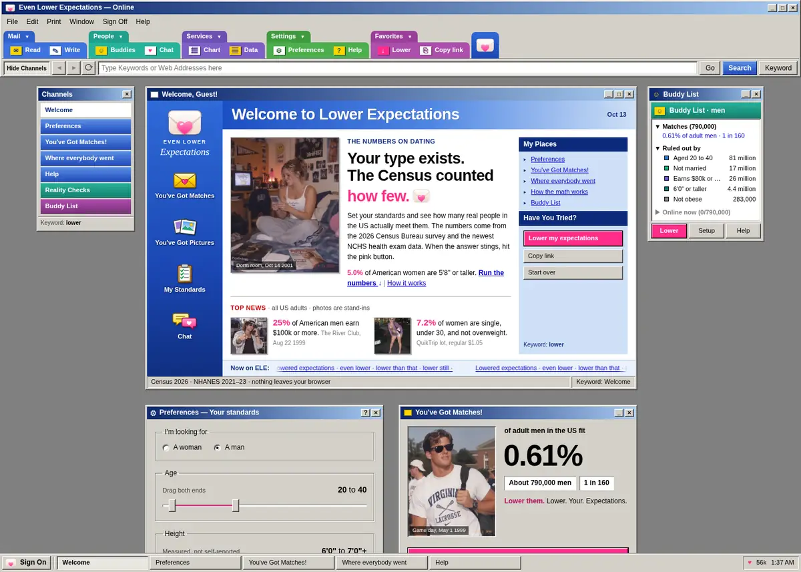

# Even Lower Expectations

**Live: [even-lower-expectations.vercel.app](https://even-lower-expectations.vercel.app)**



A dating reality check. Pick who you're looking for, set your standards, and see how many adults in the US actually fit. Then press the pink button and lower the bar, one standard at a time.

It combines [realitycalc.com](https://realitycalc.com/) and [igotstandardsbro.com](https://igotstandardsbro.com/) into one page and swaps in newer data. The name is a nod to MADtv's "Lowered Expectations" sketch. No affiliation.

## Data

| Survey | Agency | Collected | Used for |
|---|---|---|---|
| CPS ASEC 2026 | US Census Bureau | Feb–Apr 2026 (2025 income) | Age, race, marriage, kids at home, income |
| NHANES Aug 2021–Aug 2023 | NCHS | Aug 2021–Aug 2023 | Measured height and BMI |

The two surveys are matched on sex, age and race, then multiplied. That assumes height and weight don't depend on income, marriage or kids once age and race are fixed. The method section on the site spells out the rest.

## What's on the page

| Window | What it does |
|---|---|
| Preferences | Age, height, income, race and deal breakers |
| You've Got Matches! | Share of US adults who fit, the count, and 1-in-N |
| AOL Video | Two 1990s video dating tapes, played back at dial-up quality |
| Where everybody went | 1,000 squares showing which standard cut who |
| Buddy List | The same cuts as a sidebar |

Photos and video are stand-ins, not survey respondents. All images are local WebP files and the video is 160×160 at 12 frames a second, about 90 KB per tape.

## Run it

```sh
pnpm install
pnpm dev
```

## Rebuild the data

Download these three files into one folder:

- `pppub26.csv` from https://www2.census.gov/programs-surveys/cps/datasets/2026/march/asecpub26csv.zip
- https://wwwn.cdc.gov/Nchs/Data/Nhanes/Public/2021/DataFiles/DEMO_L.xpt
- https://wwwn.cdc.gov/Nchs/Data/Nhanes/Public/2021/DataFiles/BMX_L.xpt

Then run `pnpm data /path/to/folder`. It writes `public/data/cps.json` and `public/data/nhanes.json`. Python 3 standard library only.

## Checks

`pnpm typecheck`, `pnpm lint`, `pnpm test`. The tests run against the real data and check it against published numbers, like adult obesity near 40%.
